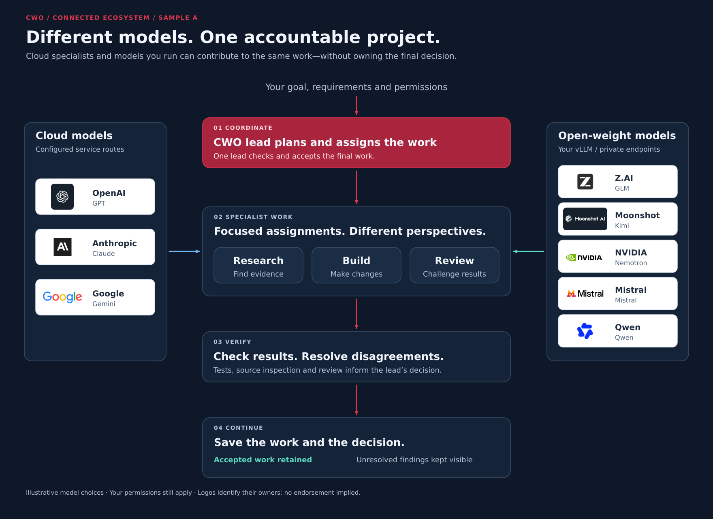
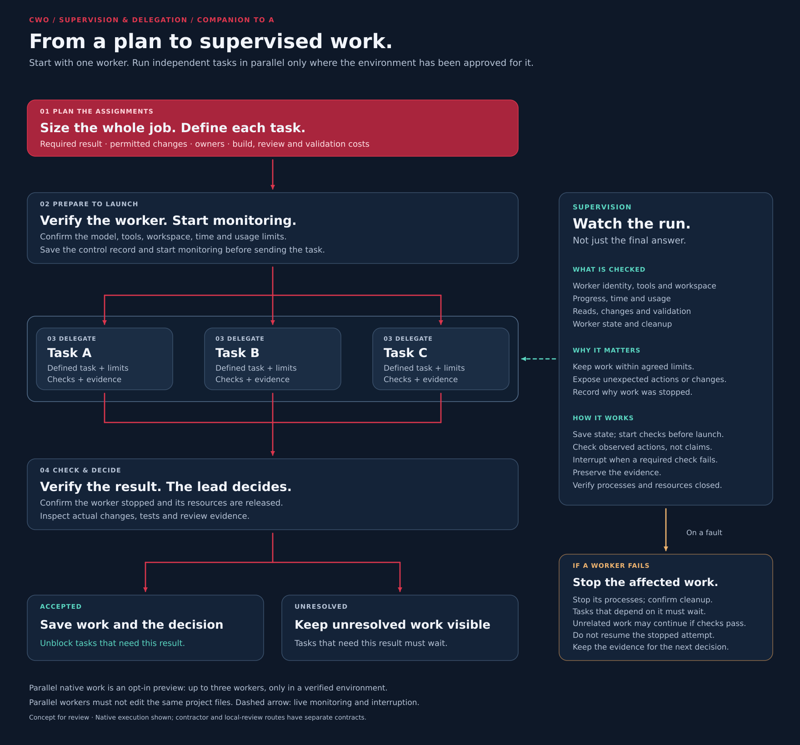
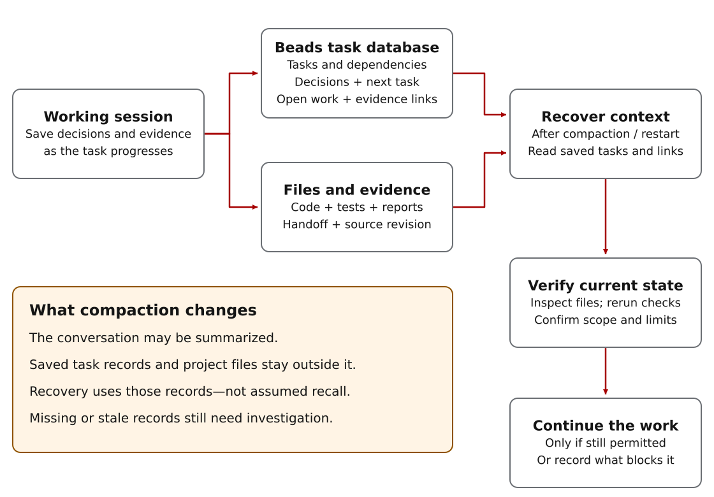

# Complex Work Orchestration

**Delegate the work. Keep the definition of done.**

CWO is a Codex skill that brings approved cloud specialists and your own
vLLM-hosted models into a project as reviewers. vLLM serves models through an
endpoint you control. Give reviewers focused questions, check what comes back,
and carry verified findings into the next task or session. You set the outcome
and permissions; one lead agent coordinates the work, and Beads stores tasks and their dependencies.

**No model gets implicit trust.** Public-cloud and open-weight models are untrusted
contributors. Using a model without guardrails is a choice to trust it implicitly.
Limit its access, check its work and keep consequential actions within your
permissions. Guardrails reduce risk; they do not make the model trustworthy.

## Plan across models, then supervise the work

One lead coordinates approved cloud and open-weight contributors, compares their
findings and keeps acceptance decisions connected to the project. Neither a
public-cloud model nor a model you run yourself is a trusted authority: useful
contributions still need evidence checks and permitted access.

[Explore the interactive architecture and zero-trust Review note](https://gprocunier.github.io/complex-work-orchestration/#ecosystem).
The logos show model options, not endorsements or a qualification matrix.

The next layer turns the plan into bounded assignments. Native supervision starts
before dispatch and observes the work as it runs; completion alone is not
acceptance. One worker is the default. Parallel work requires independent tasks,
separate write ownership and an approved, qualified environment.

[Read the delegation guide](https://gprocunier.github.io/complex-work-orchestration/native-supervision.html).
Concurrent native groups are an opt-in preview, currently up to three workers.
Other review routes have separate contracts. These guardrails manage risk; they
cannot make untrusted models inherently trustworthy or guarantee safety.

### Plan your task with Prompt Coach

Start with [Prompt Coach](https://gprocunier.github.io/complex-work-orchestration/prompt-coach.html)
to define the result, size the whole job and decide which questions need another
model. The lead drafts a plan; approved reviewers provide separate second
opinions; synthesis turns supported findings into plan changes before execution.

**Example: “retry twice” is not a complete plan.** A job-submission timeout may
happen after the server creates the job. In the
[planning example](https://gprocunier.github.io/complex-work-orchestration/model-synthesis.html#planning-example),
a cloud reviewer challenges the retry assumption and a local vLLM reviewer raises
restart behavior. The revised plan checks duplicate protection and adds lost-reply
and restart tests before enabling retries. These are illustrative findings, not
recorded model responses or proof that a model combination performs better.

## Keep project memory beyond the conversation

Long conversations are compacted: earlier messages are summarized to fit the
model's working context. A fresh session may not have the earlier conversation
at all. CWO keeps the project record outside that context rather than relying on
a model to remember the whole job.

**Beads is the task database CWO uses for durable project memory.** It stores
tasks and dependencies; CWO uses task notes and linked records for accepted
decisions, open questions and the permitted next action. Code, tests, saved
reports and the handoff remain in project files.

After compaction or a restart, CWO reads the relevant records, checks the current
checkout and remaining limits, and continues only permitted work. Accepted work
is retained; a stopped attempt is not silently restarted. Missing or stale
records need investigation—this is not perfect recall or automatic capture of
every message. The diagram illustrates the workflow, not a new compaction trial.

[What to save and how to recover](https://gprocunier.github.io/complex-work-orchestration/beads-memory.html#compaction).
Local records are not remote backup; shared recovery needs separately configured
and verified synchronization.

## Put specialist findings to work

- **Use local models as project reviewers.** Send a focused question to an approved
  private endpoint, including OpenShift AI vLLM. CWO records the request and applies
  the selected route's response checks before evaluation.
  [Use a local reviewer](https://gprocunier.github.io/complex-work-orchestration/local-workers.html).
- **Investigate disagreement rather than averaging it away.** Preserve separate
  findings and their evidence. When structured comparison is needed, invoke CWO's
  comparison API with explicit claims, then check the disputed behavior.
  [Inspect the comparison test](https://gprocunier.github.io/complex-work-orchestration/zero-trust-consensus.html#tested-example).
- **Continue from the accepted decision.** Retain requirements, actual checks,
  unresolved risks and the permitted next task alongside the work.
  [Continue in a fresh session](https://gprocunier.github.io/complex-work-orchestration/continue-project.html).

Local review does not make a cloud session offline. Different models may contribute
useful findings, but more models do not guarantee better answers. Structured
cross-return comparison is explicitly invoked; it is not an automatic gate on
every call. [How CWO fits the ecosystem](https://gprocunier.github.io/complex-work-orchestration/explanation.html#ecosystem).

## Preserve the project requirements when work changes

- **Keep evaluations comparable.** Save the test cases, scoring and selection rule
  before comparing approaches. Repair a broken runner without quietly making the
  test easier. CWO's protocol validator checks recorded fields when invoked; it
  cannot detect every unrecorded change in intent.
- **Account for failed attempts.** Preserve the failure, inspect files and cleanup,
  and account for allowance already used. Continue unrelated work only when it is
  still permitted and its own checks pass; do not silently restart an attempt that has already ended and used its allowance.

[Use CWO on your project](https://gprocunier.github.io/complex-work-orchestration/workflows.html#operator)
or [add CWO to Codex](https://gprocunier.github.io/complex-work-orchestration/install.html).
New to project agents? [Try the guided practice example](https://gprocunier.github.io/complex-work-orchestration/get-started.html).

## Inspect the implementation and recorded work

**Repository component tests, using authored inputs:**
[local-response checks](https://gprocunier.github.io/complex-work-orchestration/use-cases.html#local-review-checks)
show usable and rejected responses; [structured claim comparison](https://gprocunier.github.io/complex-work-orchestration/use-cases.html#claim-comparison)
retains conflicting encryption claims without deciding which is true. These are
existing tests, not live provider conversations or endpoint qualification.

**Recorded agent work:** a [configuration-validator exercise across two fresh sessions](examples/first-project/VALIDATION.md)
fixed a Python program that checks server names and port numbers, then added
a terminal command without changing those validation rules; eleven project
tests passed. A separate [documentation-command review](examples/release-readiness/RECORD.md) found an
encoding failure the first eight tests missed. The lead reproduced it, fixed JSON
escaping and added a real subprocess regression. These small cases demonstrate
review and continuation—not native concurrency or comparative productivity. The
current split tutorial has not had another full two-session model run.

**Designs to adapt, not completed demonstrations:**
[compare converters against unchanged requirements](https://gprocunier.github.io/complex-work-orchestration/use-cases.html#migration-evaluation)
and [avoid duplicate jobs when retrying](https://gprocunier.github.io/complex-work-orchestration/use-cases.html#retry-decision).
Each identifies the work and checks an integrated demonstration would need.

## Match coordination to the task

A small edit may need one lead and focused validation. Add saved dependencies,
specialist reviews, supervised delegation and handoffs when later work depends
on earlier decisions or another session must continue the project. Assignments,
records, specialist calls and repeated checks consume time and model quota.

Using fewer coordination steps does not remove the need for access limits and
evidence checks. Every model remains untrusted, including the lead. Check its
work too; a coordinating role does not make its judgments correct.

Codex already plans, edits, uses tools and can delegate. Beads stores task state.
CWO connects them through project instructions, saved decisions, evidence checks
and supervised delegation on supported routes. Some safeguards are code; others
are instructions. Neither replaces the host's tool permissions or sandbox.
[Understand these limits](https://gprocunier.github.io/complex-work-orchestration/explanation.html).

## Setup

You need an authenticated Codex CLI, Python 3, Git and
[Beads](https://github.com/gastownhall/beads). Follow the
[setup sequence](https://gprocunier.github.io/complex-work-orchestration/get-started.html#install)
to keep the source checkout, installed skill and target project separate.
Install and verify the named operator profile, then start a **fresh** session.
Resuming an older conversation does not load that profile. Default profile settings
remain intact; the installed CWO skill remains available in ordinary sessions
until disabled or removed.

CWO does not include model access; your account supplies it and its quota. Local
task records do not mean prompts stay offline. Your configured model provider
receives selected context. Additional outside review is off by default.

## Status and detailed controls

CWO is a development-stage public skill package. See [VERSION](VERSION) and
[CHANGELOG](CHANGELOG.md); neither implies a Git tag or a deployed site version.

- CWO uses a system prompt optimized for complex project work rather than the
  default OpenAI system prompt. The [CWO system prompt](references/cwo-system-prompt.md)
  explains its intended behavior, setup and limits—not measured superiority.
- Current native delegation sizes the task before selecting a qualified exact
  Luna worker; Terra requires a recorded escalation. Historical Spark records do
  not approve new dispatches. [Delegation guide](https://gprocunier.github.io/complex-work-orchestration/native-supervision.html).
- Concurrent native work is a host-qualified preview for fixed groups, not a
  setup requirement or proof that this session can run several workers.
- Outside review, local models and alternate agent tools are optional.
  Each needs its own access, permission and availability checks.
- [Reference and troubleshooting](https://gprocunier.github.io/complex-work-orchestration/reference.html)
  links the exact installation, update, policy and recovery instructions.
- [Security policy](SECURITY.md) · [Threat model](references/security-threat-model.md)
  · [Documentation maintenance](CONTRIBUTING.md).

Code is licensed under [GPL-3.0](LICENSE). Passing local checks does not authorize
committing, pushing, deployment or changing a live skill installation.
