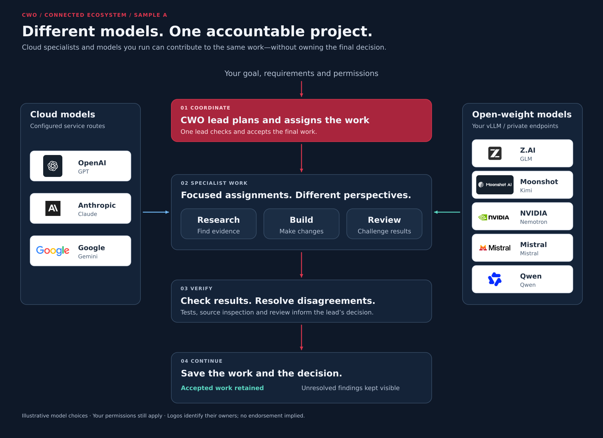
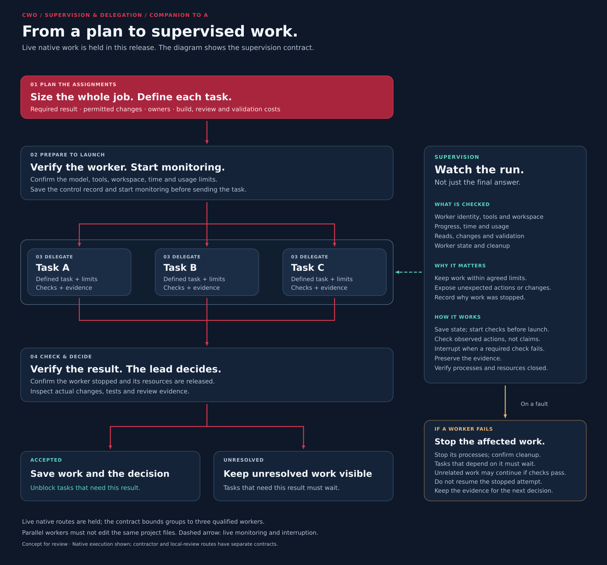
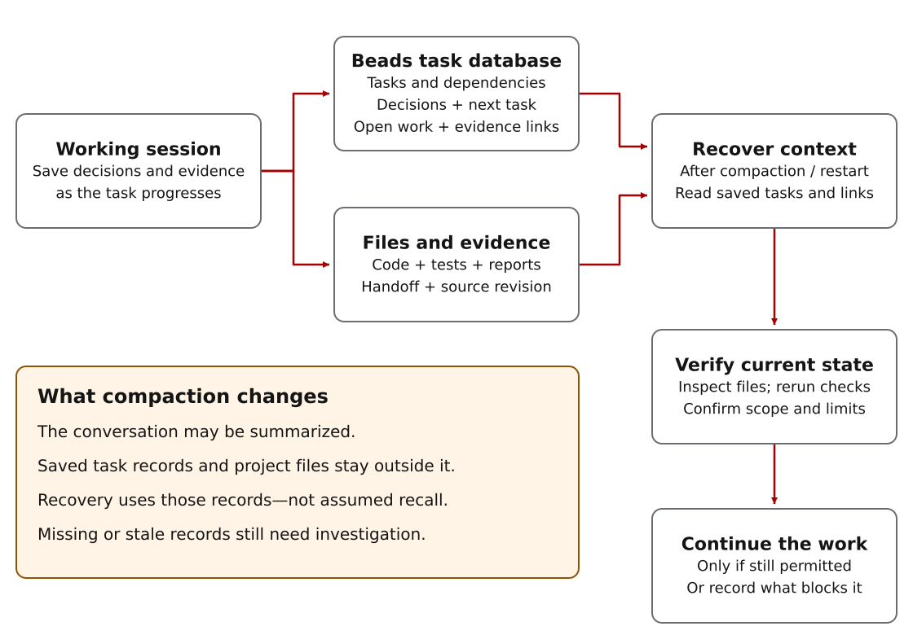

# Complex Work Orchestration

**Delegate the work. Keep the definition of done.**

CWO is a Codex skill that brings approved cloud specialists and your own
vLLM-hosted models into a project as reviewers. vLLM serves models through an
endpoint you control. Give reviewers focused questions, check what comes back,
and carry verified findings into the next task or session. You set the outcome
and permissions; one lead agent coordinates the work, and Beads stores tasks and their dependencies.

**No model gets implicit trust.** Public-cloud and open-weight models are untrusted
contributors. Using a model without guardrails is a choice to trust it implicitly.
Limit its access, check its work and keep consequential actions within your
permissions. Guardrails reduce risk; they do not make the model trustworthy.

## What CWO does today

- **Plans before anyone edits.** Prompt Coach defines the result, sizes the job
  and names the questions worth a second opinion. It does not call reviewers or
  authorize implementation.
- **Keeps the project record outside the conversation.** Beads holds tasks,
  dependencies and accepted decisions, so a fresh session can continue after
  compaction or a restart. It is a saved record, not perfect recall.
- **Prepares focused review requests and checks the returns.** CWO builds and
  validates request packets for approved cloud or local reviewers, then
  normalizes and evaluates what comes back. In this version CWO does not send
  them itself: local HTTP dispatch (`dispatch_work.py --execute-local`) and live
  browser dispatch are disabled, so you send the exported request and bring the
  response back.
- **Defines supervision for delegated native work.** Live native launchers are
  held in this release. In the supervision contract, the lead
  checks the worker's recorded activity while it runs, and completion alone is
  not acceptance. These checks are cooperative: the lead runs them, and nothing
  stops a lead that skips one.
- **Keeps delivered work open until it is accepted.** Delivered work is recorded
  as `pending-acceptance` and the Bead stays open for you. Successful closure is
  refused until CWO can verify the requirement baseline, the delivered candidate
  and its evidence (issue #37).

The [Limits](#limits) section lists what CWO does not do.

## Setup

Tested on Linux with Python 3.12 and 3.14. Other operating systems and
interpreter versions are untested. You need an authenticated Codex CLI, Git and
[Beads](https://github.com/gastownhall/beads). Keep three folders separate: the
CWO source checkout, the installed skill and your target project. From the
source checkout, following the
[setup sequence](https://gprocunier.github.io/complex-work-orchestration/get-started.html#install):

```bash
./scripts/install.sh --yes --dry-run
./scripts/install.sh --yes
python3 scripts/check_installed_skill.py --check
python3 scripts/manage_instruction_profile.py install --profile operator-e
python3 scripts/manage_instruction_profile.py verify --profile operator-e
```

Then start a **fresh** session in your project with the named profile
`cwo-sol-operator-e`:

```bash
cwo-codex -C "$PWD"
# equivalent: codex --profile cwo-sol-operator-e -C "$PWD"
```

CWO uses a system prompt optimized for complex project work rather than the
default OpenAI system prompt; the [CWO system prompt](references/cwo-system-prompt.md)
explains its intended behavior, setup and limits, not measured superiority.
The profile requests model `gpt-5.6-sol` and inherits reasoning effort from the
host or user. The architect executor in `policy/execution-environments.yaml`
binds `gpt-6.1-sol`; that route binding is separate from the bundled profile.
Check the selected route and actual model/effort in the running session.
Resuming an older conversation does not load that profile. Default profile
settings remain intact; the installed CWO skill remains available in ordinary
sessions until disabled or removed.

CWO does not include model access; your account supplies it and its quota. Local
task records do not mean prompts stay offline. Your configured model provider
receives selected context. Additional outside review is off by default.

## Example: one project across two fresh sessions

This is recorded work, not an illustration. On October 15, 2026, two fresh
named-profile sessions worked on the practice project, a small Python program
that checks server names and port numbers:

1. The first session repaired only the validator, saved its accepted decision
   about boolean ports in Beads, and created a terminal-command task that
   depends on the validator. The six original validator tests passed.
2. The second session read the project files, `HANDOFF.md` and Beads, checked
   the accepted validator behavior before editing, then added the command and
   five subprocess tests. All eleven project tests passed in an independent run.

Limits of this record: one configured Linux host and one existing account; not
a novice study, benchmark or cost claim. The practice pages have since been
split and have not had another full two-session model run, and that run
predates the closure change, so the same work would now end at
`pending-acceptance`. [Read the record](examples/first-project/VALIDATION.md)
or [try the guided practice example](https://gprocunier.github.io/complex-work-orchestration/get-started.html).

## Plan across models, then supervise the work

One lead coordinates approved cloud and open-weight contributors, compares their
findings and keeps acceptance decisions connected to the project. Neither a
public-cloud model nor a model you run yourself is a trusted authority: useful
contributions still need evidence checks and permitted access.

[](https://gprocunier.github.io/complex-work-orchestration/#ecosystem)

[Explore the interactive architecture and zero-trust Review note](https://gprocunier.github.io/complex-work-orchestration/#ecosystem).
The logos show model options, not endorsements or a qualification matrix.

The next layer turns the plan into bounded assignments. The native
delegation contract sizes the task first and then selects a qualified exact worker:
`gpt-5.6-luna` first, `gpt-5.6-terra` only with a recorded escalation.
Parallel work requires independent tasks, separate write ownership and an
approved, qualified environment.

[](https://gprocunier.github.io/complex-work-orchestration/#supervised-execution)

[Read the delegation guide](https://gprocunier.github.io/complex-work-orchestration/native-supervision.html).
The registered single-worker route, concurrent pools and live campaigns are
unavailable in this release under default-off source holds. A qualified worker
means an exact model, executable, configuration and enforced tool profile with
matching observed capability evidence for the selected assignment. New worker-
surface qualification is also held; existing receipts cannot restore a route.
The pool contract bounds groups to three and additionally requires a trusted
controller, which is not shipped.

### Plan your task with Prompt Coach

Start with [Prompt Coach](https://gprocunier.github.io/complex-work-orchestration/prompt-coach.html)
to define the result, size the whole job and decide which questions need another
model. The lead drafts a plan; approved reviewers provide separate second
opinions; synthesis turns supported findings into plan changes before execution.
The [planning example](https://gprocunier.github.io/complex-work-orchestration/model-synthesis.html#planning-example)
shows a retry plan revised after two reviews. Its findings are illustrative,
not recorded model responses or proof that a model combination performs better.

## Keep project memory beyond the conversation

Long conversations are compacted: earlier messages are summarized to fit the
model's working context. A fresh session may not have the earlier conversation
at all. CWO keeps the project record outside that context rather than relying on
a model to remember the whole job.

**Beads is the task database CWO uses for durable project memory.** It stores
tasks and dependencies; CWO uses task notes and linked records for accepted
decisions, open questions and the permitted next action. Code, tests, saved
reports and the handoff remain in project files.

[](https://gprocunier.github.io/complex-work-orchestration/#durable-memory)

After compaction or a restart, CWO reads the relevant records, checks the current
checkout and remaining limits, and continues only permitted work. Accepted work
is retained; a stopped attempt is not silently restarted. Missing or stale
records need investigation. The diagram illustrates the workflow, not a new
compaction trial.

[What to save and how to recover](https://gprocunier.github.io/complex-work-orchestration/beads-memory.html#compaction).
Local records are not remote backup; shared recovery needs separately configured
and verified synchronization.

## Match coordination to the task

A small edit may need one lead and focused validation. Add saved dependencies,
specialist reviews, supervised delegation and handoffs when later work depends
on earlier decisions or another session must continue the project. Assignments,
records, specialist calls and repeated checks consume time and model quota.

- **Narrow fix:** one Bead created with `bd create`, worked in the lead's
  thread.
- **Tight chain:** `python3 scripts/scaffold_workgraph.py --title "<goal>"
  --description "<scope>" --scaffold-size tight`. It drops optional specialist
  review lanes only; required evaluation, peer review, editorial gates, publish
  sanitization, risk-required experts and named architecture critics stay.
- **Full graph:** the same command without `--scaffold-size`, for broad, risky,
  multi-lane, reviewed or release-sensitive work.

Both graph sizes put implementation and docs before validation and the other
final checks, and the wrap-up report and handoff after the last of them. No
smaller scaffold tier is available: `--scaffold-size` accepts only `full` and
`tight`, and a request that asks for a "minimal scaffold" gets the tight chain.
[Scaffold sizes](references/prompt-coach.md#scaffold-size).

Using fewer coordination steps does not remove the need for access limits and
evidence checks. Every model remains untrusted, including the lead. Check its
work too; a coordinating role does not make its judgments correct.

Codex already plans, edits, uses tools and can delegate. Beads stores task state.
CWO connects them through project instructions, saved decisions, evidence checks
and supervised delegation on supported routes. Some safeguards are code; others
are instructions. Neither replaces the host's tool permissions or sandbox.

## Limits

- **Checks are cooperative.** Helper gates refuse when they are invoked and
  their inputs fail; supervision checks classify a worker's recorded activity
  when the lead runs them. Neither stops a lead that skips them.
- **No boundary of its own.** CWO works inside whatever sandbox and approval
  policy the host is configured with. A lead launched with Codex `--yolo` has
  those checks disabled, and CWO supplies nothing in their place.
- **Disabled in this version:** local HTTP dispatch, live browser dispatch and
  browser model confirmation; registered native single-worker, pool and
  campaign live routes; new worker-surface qualification; live native activation
  (`run_native_pool_activation_preview.py run --enable-tech-preview`);
  successful closure; risk narrowing (`--risk-scope` and `--risk-evidence-dir`
  are refused); ordinary productive pool plans; and process termination by
  `cleanup_stale_agents.py`, which only detects and prunes records.
- **Records are evidence, not proof of origin.** Content digests and packet
  `attestation` values identify exact bytes; they do not authenticate who
  produced them. The configured host audit checks retained events, links, a
  private head checkpoint and ordered segment seals. History inconsistent with
  that retained checkpoint refuses verification. Custom legacy diagnostic logs
  lack that checkpoint. A same-account writer can erase the state or rewrite
  and rehash the chain and checkpoint; neither path authenticates the operator
  or has an external anchor.
- **More models do not mean better answers.** Different models may contribute
  useful findings, but agreement is not validation, and a local reviewer does
  not make a cloud session offline. Structured cross-return comparison runs
  only when explicitly invoked.

The [claims register](references/claims-register.md) maps each safety claim to
its mechanism and limit. [Understand these limits](https://gprocunier.github.io/complex-work-orchestration/explanation.html).

## Glossary

- **Lead:** the main Codex session running CWO. It plans, coordinates and
  records decisions, and its work needs checks too.
- **Worker:** a delegated session given one bounded assignment. A native worker
  is another Codex agent. Supervision is required: the lead must invoke the
  cooperative checks that classify a worker's recorded activity.
- **Reviewer:** a cloud or local model asked a focused question. Its return is
  evidence for the lead, not a decision.
- **Bead:** one task record in Beads (the `bd` command), with its dependencies,
  notes and closure record.
- **Scaffold:** the linked set of Beads that `scaffold_workgraph.py` creates for
  a job (the tight chain or the full graph).
- **Route:** the classification `route_work.py` assigns, such as `in-thread`,
  `internal-worker`, `local-worker` or `external-contract`. It sets required reviews and gates; it
  does not grant permission to dispatch.
- **Adjudication:** the lead's recorded decision on a return after evaluation,
  for example to accept it, accept it with changes or reject it.
- **Acceptance:** verified agreement that delivered work meets the recorded
  requirements. `pending-acceptance` means delivered and not yet accepted.
- **Operator continuation packet:** the handoff block every closeout includes,
  from `templates/operator-handoff-packet.md`.
- **Luna, Terra, Sol, Spark:** model names in the routing policy.
  `gpt-5.6-luna` is the first choice for native workers, `gpt-5.6-terra` needs a
  recorded escalation, the bundled profile requests `gpt-5.6-sol` while the policy architect executor
  binds `gpt-6.1-sol`, and
  `gpt-5.3-codex-spark` appears only in historical records.

## More detail

<a id="put-specialist-findings-to-work"></a>
<a id="preserve-the-project-requirements-when-work-changes"></a>
<a id="inspect-the-implementation-and-recorded-work"></a>

- [Reviews, requirements and recorded work](references/reviews-and-requirements.md):
  local reviewers, disagreement, unchanged evaluation requirements, failed
  attempts, component tests and recorded examples. Former sections [Put specialist
  findings to work](references/reviews-and-requirements.md#put-specialist-findings-to-work),
  [Preserve the project requirements when work changes](references/reviews-and-requirements.md#preserve-the-project-requirements-when-work-changes),
  and [Check examples against their evidence](references/reviews-and-requirements.md#check-examples-against-their-evidence)
  are now in this reference.
- [Use CWO on your project](https://gprocunier.github.io/complex-work-orchestration/workflows.html#operator)
  and [Reference and troubleshooting](https://gprocunier.github.io/complex-work-orchestration/reference.html)
  for the exact installation, update, policy and recovery instructions.
- [Security policy](SECURITY.md) · [Threat model](references/security-threat-model.md)
  · [Documentation maintenance](CONTRIBUTING.md).

<a id="status-and-detailed-controls"></a>

## Status

CWO is a development-stage public skill package. See [VERSION](VERSION) and
[CHANGELOG](CHANGELOG.md); neither implies a Git tag or a deployed site version.
Historical Spark records do not approve new dispatches. Concurrent native work
is unavailable in this release; the capacity contract does not approve a launch. Outside review, local models and
alternate agent tools are optional, and each needs its own access, permission
and availability checks.

Code is licensed under [GPL-3.0](LICENSE). Passing local checks does not authorize
committing, pushing, deployment or changing a live skill installation.
