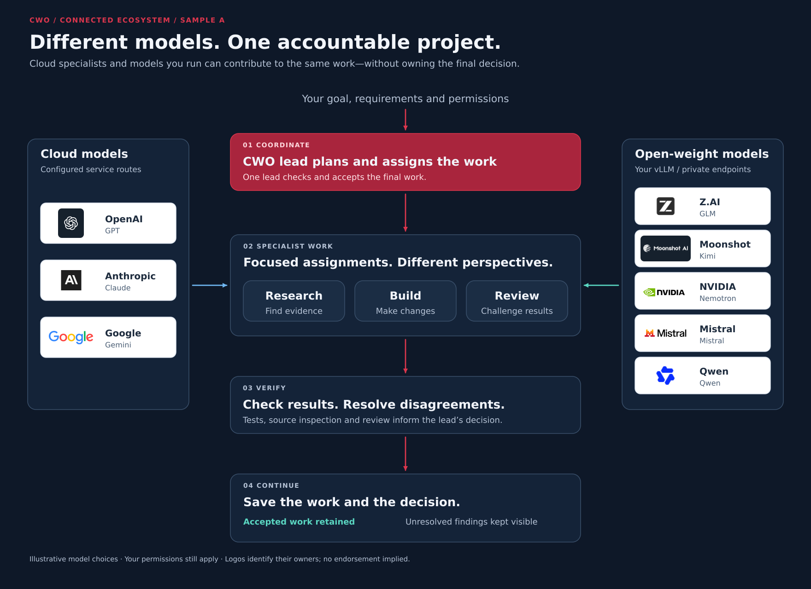

# Complex Work Orchestration

**Delegate the work. Keep the definition of done.**

CWO is a Codex skill that brings approved cloud specialists and your own
vLLM-hosted models into a project as reviewers. vLLM serves models through an
endpoint you control. Give reviewers focused questions, check what comes back,
and carry verified findings into the next task or session. You set the outcome
and permissions; one lead agent coordinates the work, and Beads stores tasks and their dependencies.

**No model gets implicit trust.** Check model findings against evidence. The
lead runs with the access granted to its host session. CWO relies on the lead
to honor your scope and approvals. The supervisor host treats registered worker
responses and tool requests as untrusted.

## What CWO does today

- **Plans before anyone edits.** Prompt Coach defines the result, sizes the job
  and names the questions worth a second opinion. It does not call reviewers or
  authorize implementation.
- **Keeps the project record outside the conversation.** Beads holds tasks,
  dependencies and accepted decisions, so a fresh session can continue after
  compaction or a restart. It is a saved record, not perfect recall.
- **Prepares focused review requests and checks the returns.** CWO builds and
  validates request packets for approved cloud or local reviewers. Managed
  expert reviews carry the registry's required inputs and check sizing against
  the prepared export. For local models, CWO can send the screened request to a
  configured vLLM endpoint after workload admission and evaluate the reply.
  [Dispatch readiness](references/run-readiness.md#dispatch-readiness)
  · [Local model dispatch](references/local-inference.md#dispatch)
  · [Desktop workflow for ChatGPT Pro](references/chatgpt-pro-browser.md).
- **Connects registered single-worker dispatch to hand review.** The installed
  launcher uses Codex's foreground approval for an exact registered assignment.
  The controller retains that approval so `cwo delegate` can deliver the
  validated result and leave it open for an independent reviewer.
  In the advisory supervision path, the lead checks the worker's recorded
  activity while it runs.
- **Keeps delivered work open until it is accepted.** The lead records a
  `pending-acceptance` delivery. A reviewer working by hand can accept and close
  it in one command using the exact candidate digest they reviewed. Closure
  requires the current requirement baseline and no open blockers or children.
  The evaluator can accept a failure report as evidence. Delivery readiness
  depends on checked obligations from the current baseline.
  [Accept a delivery by hand](references/run-readiness.md#accepting-a-delivery-by-hand)
  or see the [verified closure library](references/run-readiness.md#verified-closure-library)
  for embedding hosts.

The [Limits](#limits) section lists what CWO does not do.

## Which way to work

| Mode | When to use it |
| --- | --- |
| **Architect profile (`cwo-codex`)** | Coordinate delegated work across sessions. Workers make the code edits through CWO's tools, and a separate reviewer accepts the delivery. |
| **Plain Codex with the CWO skill** | Make a quick, hands-on repair in one sitting. The [practice walkthrough](#example-one-project-across-two-fresh-sessions) uses plain sessions for in-thread edits. |

The [installer](docs/install.html#install) can set up and check the dedicated
worker login. Actual delegation uses the protected, signed single-worker
workflow. For an eligible assignment with one known text output, the local
architect session can ask for standing approval. `cwo delegate` uses the
retained approval to dispatch the worker.

Set the architect launcher's model, reasoning effort and service tier under the
Sol role (`sol`) in [`policy/model-roles.yaml`](policy/model-roles.yaml). Use the
same settings in plain Codex for a like-for-like comparison. Cyber fallback is opt-in.
Candidate E is retired.

## Setup

Tested on Linux with Python 3.12 and 3.14. Other operating systems and
interpreter versions are untested. You need an authenticated Codex CLI, Git and
[Beads](https://github.com/gastownhall/beads). Keep three folders separate: the
CWO source checkout, the installed skill and your target project. From the
source checkout, following the
[setup sequence](https://gprocunier.github.io/complex-work-orchestration/get-started.html#install):

```bash
./scripts/install.sh --yes --dry-run
./scripts/install.sh --yes
python3 scripts/check_installed_skill.py --check
```

To opt in to the CWO architect prompt, run these commands from the installed
skill directory reported by the installer:

```bash
python3 scripts/manage_instruction_profile.py install --profile architect
python3 scripts/manage_instruction_profile.py verify --profile architect
```

Start a fresh session in your project:

```bash
cwo-codex -C "$PWD"
```

The profile replaces Codex's base instructions for that session. Its only setting
is `model_instructions_file`. To select the same prompt using your Codex settings,
run `codex --profile cwo-architect -C "$PWD"`. Verify the active settings in the
new session. The CWO skill remains available in ordinary sessions until
disabled or removed. See the [architect prompt reference](references/cwo-system-prompt.md).

CWO does not include model access; your account supplies it and its quota. Local
task records do not mean prompts stay offline. Your configured model provider
receives selected context. Additional outside review is off by default.
Inspect the [redacted and screened packet](references/external-contracting.md#trust-model-and-enforcement-boundary)
before sharing it with an outside reviewer.

### Upgrading from 0.2.0-dev

See the [upgrade note](references/upgrading-from-0.2.md) for review routes,
custom reviewer profiles and where to find saved audit records and packets.

### Checking a source change

Hosted CI runs the full unit suite on Python 3.12 and 3.14. It also checks
types and enforces a measured coverage floor for selected modules. The
code-health check prevents maintainability regressions and records reductions
in unused names, private imports and validator complexity.
See [CI validation](references/ci-validation.md) for the check scope and local commands.

## Example: one project across two fresh sessions

On October 15, 2026, before the architect prompt replaced Candidate E, two
named-profile sessions worked on the practice project, a small Python program
that checks server names and port numbers:

1. The first session repaired only the validator, saved its accepted decision
   about boolean ports in Beads, and created a terminal-command task that
   depends on the validator. The six original validator tests passed.
2. The second session read the project files, `HANDOFF.md` and Beads, checked
   the accepted validator behavior before editing, then added the command and
   five subprocess tests. All eleven project tests passed in an independent run.

Limits of this record: one configured Linux host and one existing account; not
a novice study, benchmark or cost claim. The practice pages have since been
split and have not had another full two-session model run, and that run
predates the closure change, so the same work would now end at
`pending-acceptance`. [Read the record](examples/first-project/VALIDATION.md)
or [try the guided practice example](https://gprocunier.github.io/complex-work-orchestration/get-started.html).

## Plan across models, then supervise the work

One lead coordinates approved cloud and open-weight contributors, compares their
findings and keeps acceptance decisions connected to the project. Neither a
public-cloud model nor a model you run yourself is a trusted authority: useful
contributions still need evidence checks and permitted access.

[](https://gprocunier.github.io/complex-work-orchestration/#ecosystem)

[Explore the interactive architecture and zero-trust Review note](https://gprocunier.github.io/complex-work-orchestration/#ecosystem).
The logos show model options, not endorsements or a qualification matrix.

The next layer turns the plan into bounded assignments. The native delegation
contract sizes the task before selecting a model. Luna handles focused native
work, Sol handles recorded coding escalation, and Terra handles assignments
explicitly classified as interface, visual or computer-use work.
`policy/model-roles.yaml` defines the current and previous model for each role.
The provider registry classifies host Codex as `host-internal`. Generated
output still requires evidence checks.
The Codex lead, workers and reviewers start at `high` reasoning effort. CWO can
select `xhigh` for a worker or reviewer when the task calls for it and records
the reason with the dispatch. See [reasoning effort routing](references/native-supervision.md#reasoning-effort-routing).
Users with Daybreak Blue access may add the optional `cyber_fallback` role and
mark authorized security work in a private file outside the lead and worker
write roots. A structured provider refusal can then make one fully charged
fallback attempt. Unmarked work and every other failure keep their normal path.
Parallel work requires independent tasks, separate write ownership and an
approved, qualified environment.

The workshop handoff comparison records decisions, elapsed time, and token
use for CWO and plain Codex on six fixed cases. [Evaluation evidence](references/evaluation-evidence.md#workshop-handoff-comparison)

[](https://gprocunier.github.io/complex-work-orchestration/#supervised-execution)

[Read the delegation guide](https://gprocunier.github.io/complex-work-orchestration/native-supervision.html).
The registered single-worker route uses an original signed workflow with
explicit OpenAI disclosure consent and a dedicated worker login. The host
checks the selected model, software, workspace and tool profile. Its app
server has provider-only network access. After the protected controller retains
the approval, run `cwo delegate` from the project checkout to send the exact
eligible assignment and post a bound delivery for hand acceptance. See the
[configured host and single-worker requirements](references/native-live-route-holds.md#standing-approved-delegation).

The [registered contained pool](references/native-supervision-pools.md)
runs two or three preapproved, independent assignments on one trusted host.
Each app server sees a read-only checkout and reaches only the model provider.
The registered writer can create an exact approved output or apply a checked
worker-authored patch to one existing assigned file in its checkout.
For a patch assignment, the host verifies the approved starting file and
includes its bounded, screened source in the worker turn.
Each worker uses a separate configured login. A three-worker qualification can
use the existing dedicated logins as a complete roster. The host accounts for
calibration and execution against the approved allowance.

The native app-server integration supports Codex CLI 0.163.0 and later releases
that provide the required protocol capabilities. CWO checks the installed CLI's
schema and names any required capability it cannot verify. See the
[Codex protocol compatibility reference](references/codex-protocol-capability-matrix.md).

The selected general `constrained-integrity` profile remains unqualified.
Confidential operation remains unsupported.

### Plan your task with Prompt Coach

Start with [Prompt Coach](https://gprocunier.github.io/complex-work-orchestration/prompt-coach.html)
to define the result, size the whole job and decide which questions need another
model. The lead drafts a plan; approved reviewers provide separate second
opinions; synthesis turns supported findings into plan changes before execution.
The [planning example](https://gprocunier.github.io/complex-work-orchestration/model-synthesis.html#planning-example)
shows a retry plan revised after two illustrative reviews. Use the
[offline synthesis report](references/zero-trust-consensus.md#invocation-boundary)
to combine your own evaluated critic returns and compare explicit claims. The
lead still adjudicates each return and resolves material disagreement.
[Return screening](references/external-contracting.md#return-screening) flags
instructions and unsupported claims that need adjudication before use.

## Keep project memory beyond the conversation

Long conversations are compacted: earlier messages are summarized to fit the
model's working context. A fresh session may not have the earlier conversation
at all. CWO keeps the project record outside that context rather than relying on
a model to remember the whole job.

**Beads is the task database CWO uses for durable project memory.** It stores
tasks and dependencies; CWO uses task notes and linked records for accepted
decisions, open questions and the permitted next action. Code, tests, saved
reports and the handoff remain in project files.

[](https://gprocunier.github.io/complex-work-orchestration/#durable-memory)

After compaction or a restart, CWO reads the relevant records, checks the current
checkout and remaining limits, and continues only permitted work. Accepted work
is retained; a stopped attempt is not silently restarted. Missing or stale
records need investigation. The diagram illustrates the workflow, not a new
compaction trial.

Use `cwo continue --record-run` to save the current gate and resume hint for an
epic. Use `cwo analyze` to check saved plan artifacts for disagreements before
implementation or handoff. [Commands and examples](references/run-readiness.md#saved-continuation-and-plan-analysis)

[What to save and how to recover](https://gprocunier.github.io/complex-work-orchestration/beads-memory.html#compaction).
Local records are not remote backup; shared recovery needs separately configured
and verified synchronization.

Convergence reports count corrective passes separately from productive calls
and accepted artifacts. First-pass rates use recorded first acceptance
attempts. [Convergence replay](references/run-readiness.md#projection-rules)

## Match coordination to the task

A small edit may need one lead and focused validation. Add saved dependencies,
specialist reviews, supervised delegation and handoffs when later work depends
on earlier decisions or another session must continue the project. Assignments,
records, specialist calls and repeated checks consume time and model quota.

- **Narrow fix:** one Bead created with `bd create`, worked in the lead's
  thread.
- **Tight chain:** `python3 scripts/scaffold_workgraph.py --title "<goal>"
  --description "<scope>" --scaffold-size tight`. It drops optional specialist
  review lanes only; required evaluation, peer review, editorial gates, publish
  sanitization, risk-required experts and named architecture critics stay.
- **Full graph:** the same command without `--scaffold-size`, for broad, risky,
  multi-lane, reviewed or release-sensitive work.

Add `--architecture-design` when the architect should record a design package
before implementation. The package starts with the current system and caller
experience, then records alternatives and rollout decisions.
[Architecture design](references/architecture-design.md)

Both graph sizes put implementation and docs before validation and the other
final checks, and the wrap-up report and handoff after the last of them. No
smaller scaffold tier is available: `--scaffold-size` accepts only `full` and
`tight`, and a request that asks for a "minimal scaffold" gets the tight chain.
[Scaffold sizes](references/prompt-coach.md#scaffold-size).

Using fewer coordination steps does not remove the need for access limits and
evidence checks. Check the lead's work even on small tasks.

Codex already plans, edits, uses tools and can delegate. Beads stores task state.
CWO connects them through project instructions, saved decisions, evidence checks
and supervised delegation on supported routes. Some safeguards are code. Others
are instructions. The lead session uses the host's tool permissions and sandbox.

## Limits

- **Older supervision checks are advisory.** The lead invokes them to classify
  the worker's recorded activity. Helper gates refuse when they are invoked and
  their inputs fail.
- **Boundaries depend on the entry point.** The lead uses its host sandbox
  and approval policy. Codex `--yolo` disables those checks for the lead.
  Registered single-worker execution uses the verified provider-only app-server
  namespace and separate networkless command and validator namespaces.
  Direct shell commands and browser actions outside the CWO helpers are
  governed by the host's own permissions.
- **Protected approvals and review evidence use a separate host principal.**
  Managed contractor exports check the host's approval for the assignment and
  destination. Protected synthesis uses the operator's selected panel and
  original host-captured dispatch evidence. Other same-account records remain
  subject to the lead's host permissions.
  [Threat model](references/security-threat-model.md#trust-on-the-supervisor-host)
- **ChatGPT Pro browser review runs from the ChatGPT desktop app.** The
  architect thread uses `@Chrome` in the paired profile with the operator
  present. [Desktop Chrome workflow](references/chatgpt-pro-browser.md)
- **Local calls require opt-in and a configured endpoint.**
  `dispatch_work.py --execute-local` requires original host workload admission
  and records the result as advisory evidence for review and adjudication.
- **Adding task text can only keep or raise routed risk** when the other
  inputs stay fixed. The router keeps risk evidence from earlier text
  prefixes, including text passed as a single string. Routine edits with no
  risk evidence can still route low.
  [Routing risk details](references/prompt-coach.md#routing-risk)
- **`route_work.py --json` shows compact rankings.** Read `ranked_experts`
  for ranked matches and `risk_assessment.required_experts` for experts the
  risk rules require. Use `--include-catalog` for full ranking details.
  [Routing JSON](references/prompt-coach.md#routing-json)
- **Disabled in this version:** raw native launch,
  ordinary productive pool plans passed to the standalone launcher, live campaigns, and
  risk narrowing (`--risk-scope` and `--risk-evidence-dir`
  are refused).
- **The activation preview is offline.** It supports key generation,
  preparation, approval and dry-run validation. The live preview and
  standalone native callback calibration are retired.
  [Native supervision pools](references/native-supervision-pools.md#temporary-audited-tool-boundary)
- **Worker tool-surface capture and maintenance observation are retired.** The
  maintenance checker verifies unexpired observations using the exact issuing
  control image and original session file.
  [Archived producers and observation verification](references/native-live-route-holds.md#archived-tool-surface-and-maintenance-observation-producers)
- **Verified successful closure is a library route for embedding hosts.** It
  requires the original dispatch, exact baseline and candidate, current policy,
  setup database identity and single-use host acceptance from an adjudicator
  separated from the executor, with all required clearances and no open blockers
  or children. Host records provide integrity within the host trust boundary;
  an unrestricted same-user writer can mint or replace them. The shipped review
  host producer remains held by `QUALIFIED_REVIEW_INVOCATION_AVAILABLE`.
- **Cleanup detects and prunes by default.** The CLI supplies no controller
  capability, so termination requests report `termination-unavailable`.
  Explicit in-process callers may supply the original controller's opaque
  capability for owned termination. A retained pidfd identifies one process
  lifetime; the controller capability supplies authority to use it. Registry
  records, argv matches and copied or serialized receipt fields grant no
  signalling authority. Writable records provide no hostile-writer protection,
  and one pidfd does not contain descendants. Experimental atomic child
  creation is qualified on Linux x86-64 with glibc 2.40+ and required kernel
  support. Unsupported interfaces or lifecycle profiles refuse without a
  fallback that opens a handle from the PID later.
- **Records are evidence, not proof of origin.** Content digests and packet
  `attestation` values identify exact bytes; they do not authenticate who
  produced them. The configured host audit checks retained events, links, a
  private head checkpoint and ordered segment seals. History inconsistent with
  that retained checkpoint refuses verification. Custom legacy diagnostic logs
  lack that checkpoint. A same-account writer can erase the state or rewrite
  and rehash the chain and checkpoint; neither path authenticates the operator
  or has an external anchor.
- **More models do not mean better answers.** Different models may contribute
  useful findings, but agreement is not validation, and a local reviewer does
  not make a cloud session offline. Structured cross-return comparison runs
  only when explicitly invoked.

The [claims register](references/claims-register.md) maps each safety claim to
its mechanism and limit. [Understand these limits](https://gprocunier.github.io/complex-work-orchestration/explanation.html).

## Glossary

- **Lead:** the main Codex session running CWO. It plans, coordinates and
  records decisions, and its work needs checks too.
- **Worker:** a delegated session given one bounded assignment. A native worker
  is another Codex agent. Supervision is required: the lead must invoke the
  cooperative checks that classify a worker's recorded activity.
- **Reviewer:** a cloud or local model asked a focused question. Its return is
  evidence for the lead, not a decision.
- **Bead:** one task record in Beads (the `bd` command), with its dependencies,
  notes and closure record.
- **Scaffold:** the linked set of Beads that `scaffold_workgraph.py` creates for
  a job (the tight chain or the full graph).
- **Route:** the classification `route_work.py` assigns, such as `in-thread`,
  `internal-worker`, `local-worker` or `external-contract`. It sets required reviews and gates; it
  does not grant permission to dispatch.
- **Adjudication:** the lead's recorded decision on a return after evaluation,
  for example to accept it, accept it with changes or reject it.
- **Acceptance:** verified agreement that delivered work meets the recorded
  requirements. `pending-acceptance` means delivered and not yet accepted.
- **Operator continuation packet:** the handoff block every closeout includes,
  from `templates/operator-handoff-packet.md`.
- **Model roles** include Sol for leadership, adjudication and recorded coding
  escalation, Astra for unresolved architecture review, Luna for focused native
  work, and Terra for interface, visual and computer-use work.
  Spark appears in historical records.

## More detail

<a id="put-specialist-findings-to-work"></a>
<a id="preserve-the-project-requirements-when-work-changes"></a>
<a id="inspect-the-implementation-and-recorded-work"></a>

- [Reviews, requirements and recorded work](references/reviews-and-requirements.md):
  local reviewers, disagreement, unchanged evaluation requirements, failed
  attempts, component tests and recorded examples. Former sections [Put specialist
  findings to work](references/reviews-and-requirements.md#put-specialist-findings-to-work),
  [Preserve the project requirements when work changes](references/reviews-and-requirements.md#preserve-the-project-requirements-when-work-changes),
  and [Check examples against their evidence](references/reviews-and-requirements.md#check-examples-against-their-evidence)
  are now in this reference.
- [Use CWO on your project](https://gprocunier.github.io/complex-work-orchestration/workflows.html#operator)
  and [Reference and troubleshooting](https://gprocunier.github.io/complex-work-orchestration/reference.html)
  for the exact installation, update, policy and recovery instructions.
- [Security policy](SECURITY.md) · [Threat model](references/security-threat-model.md)
  · [Documentation maintenance](CONTRIBUTING.md).

<a id="status-and-detailed-controls"></a>

## Status

CWO is a development-stage public skill package. See [VERSION](VERSION) and
[CHANGELOG](CHANGELOG.md); neither implies a Git tag or a deployed site version.
Historical Spark records do not approve new dispatches. The registered
contained pool requires original admission and fresh callback evidence on the
same host. Outside review, local models and alternate agent tools are optional,
and each needs its own access, permission and availability checks.

Code is licensed under [GPL-3.0](LICENSE). Passing local checks does not authorize
committing, pushing, deployment or changing a live skill installation.
