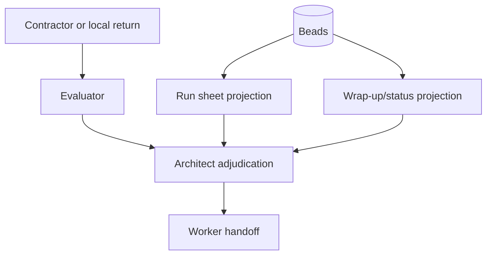

# Run Readiness Gate

Use a run readiness plan before worker handoff when a CWO run has broad
implementation scope, contractor or local-worker evidence, model synthesis, or
public/release risk.

The plan answers four questions before handoff: who owns each assignment, what
result is required, which checks establish completion, and what happens if work
cannot continue. It summarizes saved Beads state rather than creating a second
task database. Passing its validator checks the required structure; it does not
prove the work or a live integration succeeds.

## Adaptation Roadmap

| Adaptation | Status | Rule |
| --- | --- | --- |
| Run readiness gate | Implemented baseline | Validate before broad worker handoff. |
| Rubric-first readiness | Implemented as required readiness field | Create before worker handoff; evaluations, synthesis, wrap-up/status, and adjudication cite the same immutable version. |
| Run sheet projection | Implemented as projection renderer | Regenerate from Beads-backed readiness state; do not edit as parallel state. |
| Wrap-up/status projection | Implemented as projection renderer | Regenerate from Beads, validation, evaluation, and adjudication evidence. |
| Deferred work (`next_version_rail`) | Implemented as required typed entries | Every deferred item needs a reason type and follow-up Bead. |
| Patrol or recurring work | Research-only | No scheduler or autonomous recurring execution until accepted research exists. |

## Required Decisions

- Each workstream has an owner and an exit condition.
- Each validation criterion maps to an artifact, validator, or review gate.
- Rubrics have a version, owner, schema reference, and immutable-per-run rule.
- Run sheet, wrap-up/status, and next-version artifacts are typed projections
  from durable Beads state.
- External and local returns are evidence until evaluation and architect
  adjudication.
- Unsupported or boundary-breaking returns are quarantined until corroborated.
- Next-version items have a typed reason and a follow-up Bead.
- Patrol or recurring work remains research-only until ownership, locking,
  history, failure containment, and provider-neutral execution are accepted.
- Worker handoff requires evidence: changed files, validation commands,
  accepted and rejected findings, residual risks, and follow-up Beads.

## Projection Rules

`scripts/render_run_projection.py` renders human views from a validated JSON
plan whose artifact-authority block declares Beads as the canonical source.
These views are deliberately non-authoritative:

```bash
python3 scripts/render_run_projection.py examples/sample-run-readiness-plan.json --projection run-sheet
python3 scripts/render_run_projection.py examples/sample-run-readiness-plan.json --projection wrap-up-status
python3 scripts/render_run_projection.py examples/sample-run-readiness-plan.json --projection next-version
```

Use `--format json` when another helper or CI check needs structured output.
Generated run sheets and wrap-up/status reports must be regenerated from Beads
plus validation, evaluation, and adjudication records. Do not edit them as a
parallel work database.

For end-of-plan resource accounting, use the separate execution status report
renderer. It summarizes explicit work-unit, expert profile, agent/model,
main-thread, second-opinion, quality, sabotage, malpractice, and evidence
disposition telemetry from audit logs, readiness records, acceptance decisions,
and return bundles. The terminal view defaults to a compact dashboard for
80-column, half-height terminals; pass `--layout expanded` for full multi-role
or multi-model utilization rows, or `--layout summary` for grouped tables. It is
a projection only; expected-but-unavailable calls, retries, tokens, timings, or
active-time values render as `?`, structurally irrelevant telemetry renders as
`n/a`, and the JSON output includes field-level available, missing,
not-applicable, and missing-reason telemetry gap counts. When manual/provider
usage becomes available after dispatch, import it through a sanitized sidecar
before rendering:

```bash
python3 scripts/import_execution_telemetry.py --file usage-sidecar.json
python3 scripts/render_execution_status_report.py --format terminal
python3 scripts/render_execution_status_report.py --format terminal --layout expanded
python3 scripts/render_execution_status_report.py --format terminal --layout summary
python3 scripts/render_execution_status_report.py --format json
python3 scripts/replay_epic_convergence.py --input convergence-ledger.json > convergence-summary.json
python3 scripts/render_execution_status_report.py --convergence-summary convergence-summary.json --format terminal
```

Convergence replay is append-only: historical unknowns stay null rather than
being inferred or rewritten. Status output reports absolute productive,
validation, attestation, fit, monitoring, recovery, PM, architect, and unknown
call counts together with replay-target results.

Closure pressure begins when acceptance or independent validation starts. The
current work unit must carry any routine correction and one explicit
`retain`, `correct`, `quarantine`, `defer`, or `close` disposition; do not add a
routine repair child. Main-thread model and effort recommendations are
advisory. The user's selected effort remains authoritative and a recommendation
mismatch does not stop or pivot execution.

The machine-readable output is documented by
`schemas/execution-status-report.schema.json`; telemetry sidecars are documented
by `schemas/execution-telemetry-import.schema.json`.

When `adjudication_record` declares accepted, rejected, or quarantined findings,
it must also include `evidence_refs` entries with `artifact`, `artifact_type`,
and lowercase SHA-256. The wrap-up/status projection renders those refs so the
architect decision is bound to evaluator, contractor-return, synthesis,
validation, or Beads-comment evidence instead of relying on self-attested
finding text alone.

Allowed `artifact_authority.projections[].type` values are `run-sheet`,
`wrap-up-status`, and `next-version`. Each projection must declare
`canonical_source: beads` and either a `source_command` or `source_bead`.

The current renderer consumes a validated readiness-plan JSON artifact that
was built from the Beads work graph. Direct `bd` projection is intentionally
left as future helper work rather than implied by this command.

## Next-Version Reason Types

Allowed `next_version_rail.reason_type` values are:

- `out-of-scope`
- `needs-credential`
- `needs-research`
- `hardening`
- `later-version`
- `blocked`

Every deferred item must name a follow-up Bead as well as its reason. A wish list
without a task leaves the next session unable to establish ownership or readiness.

## Patrol Boundary

Patrol or recurring work is research/proposal only until the research output
accepts the typed evidence values `ownership`, `locking`, `history`,
`failure_containment`, and `provider_neutral_execution`. Do not add a
scheduler, recurring worker, persistent controller, or autonomous execution
loop as part of readiness work.

## Machine-Readable Shape

Use `schemas/run-readiness-plan.schema.json` for the JSON shape and
`examples/sample-run-readiness-plan.json` as a minimal passing example.

Validate a plan:

```bash
python3 scripts/validate_run_readiness_plan.py examples/sample-run-readiness-plan.json
```

The validator checks the schema-critical invariants CWO needs before execution:
owners, exit conditions, criterion evidence, artifact authority, rubric
immutability and `criterion_ids`, provider provenance, quarantine rules,
boundary negative tests, next-version links, patrol stopping rule, and handoff
evidence.

## Requirement Baselines

A requirement baseline records what one Bead must deliver before the work
starts, so that later checks compare results with obligations that were fixed
in advance rather than with whatever passed. It follows
`schemas/requirement-baseline.schema.json`. Each criterion has a stable ID, the
requirement and where it comes from, the expected observable outcome, whether
it applies (`required`, or `not-applicable` with a reason) and the evidence
kind it needs (`artifact`, `validator` or `review-gate`, the readiness evidence
types). The record has no place for results; a criterion carrying a status,
observation or evidence field is refused.

The baseline digest is SHA-256 over the record serialized as JSON with sorted
keys, no whitespace and UTF-8 text. The Bead retains each version by a comment
whose whole text is the reference line
`cwo-requirement-baseline bead=<id> version=<n> digest=sha256:<hex>`.
`cwo_core.requirement_baseline` checks that every version of a chain is
recorded in order and that the Bead records no other baseline; it reads a Bead
projection and never writes to Beads. A comment that carries a reference line
inside other text, or has a line that starts like one in any letter case, is
refused as well; prose that only mentions the prefix is not a reference.

An amendment (`schemas/requirement-amendment.schema.json`) names the prior
digest and version, carries the complete next baseline, and lists the
criterion IDs it adds, removes and changes, which must be exactly the
difference. Only amendments that add criteria are supported. Removing or
changing a criterion would remove or weaken an obligation, which needs
authority that CWO cannot verify yet, and a clarification cannot be told apart
from a weakening, so those amendments are refused and the baseline stays as
recorded.

A readiness plan names the baseline it follows in `requirement_baseline`
(record type, Bead, version and digest). The validator then requires the
baseline and any amendments, in order:

```bash
python3 scripts/validate_run_readiness_plan.py plan.json --baseline baseline.json --amendment amendment-1.json
```

The rubric must list exactly the baseline's required criteria, and each
matrix row must use the evidence kind the baseline records for that criterion.
An omitted, replaced or invented criterion fails. A plan that names a baseline
fails without it; projections render without this check. Readiness plans may
still reference evidence that does not exist yet.

## Candidate Identity

A candidate identity records exactly what a Bead's delivery claims, so that
evidence and approvals can bind to one candidate and any later change is
visible. It follows `schemas/candidate-identity.schema.json` and names:

- the Bead and the requirement baseline version and digest the candidate is
  meant to satisfy;
- the repository, by its root commits, the base commit the work started from
  (an ancestor of the candidate) and the candidate commit and tree;
- a manifest of every path whose working content differs from the candidate
  tree: its change, file type, mode, size and the SHA-256 of its bytes or link
  target. Untracked paths the record excludes, such as evidence directories,
  are left out; an exclusion cannot contain tracked files or delivery scope
  paths, and changed tracked files are always in the manifest. Ignored
  untracked files are not part of the candidate;
- the delivery scope: the repository paths the delivery claims, each of which
  must exist in the candidate. A scope that names live resources (a retired
  service, a deployed name) is refused, because binding their independently
  observed state needs a producer-bound observation record that does not exist
  yet;
- the SHA-256 of the full permission and special bits (read, write and
  execute for user, group and other, setuid, setgid and sticky) of the
  repository root and of every delivered file, symlink and directory. The
  manifest records Git's mode; this digest binds the rest, so a change such
  as 0644 to 0666, 0755 to 4755 or a directory made group-writable is a
  mismatch. Ignored and excluded paths are not delivered and not bound.

The record holds no results and no approvals. A commit SHA alone does not
identify dirty deliverables, and a content digest does not say who approved
the content. The candidate digest uses the same serialization as the baseline
digest, and the Bead retains a candidate by a comment whose whole text is
`cwo-candidate-identity bead=<id> digest=sha256:<hex>`:

```bash
python3 scripts/candidate_identity.py record --baseline baseline.json --base-commit <commit> --scope src --exclude evidence --output /tmp/candidate.json
python3 scripts/candidate_identity.py verify --baseline baseline.json --candidate /tmp/candidate.json --read-beads
```

The manifest comes from the inert workspace capture: raw bytes, modes and
types read from the filesystem without following symlinks, compared with the
candidate tree read from the object store. The index and its flags
(assume-unchanged, skip-worktree), `core.filemode` and Git conversions
(clean, smudge and process filters, end-of-line and encoding attributes) have
no part in it, so staging alone changes nothing and none of them can hide a
change. No Git command runs against the working tree or its repository, so no
configured filter, hook or monitor runs; the history (root commits, base
ancestry) is read from the object store, and the base commit is named by its
full object ID.

Every delivered symlink, committed or not, must resolve over the delivered
content alone to a delivered file or directory. A link into excluded, ignored
or absent content, outside the repository, into `.git`, to the repository root
or to a directory holding an excluded path is refused, because delivered
content would then depend on content the candidate does not bind. Resolution
follows the kernel: a trailing slash or a `.` after a file is refused, and a
chain of more than 40 links, counting the first, is refused. A gitlink is
refused wherever it is, even under an excluded or ignored path. Code that
opens or imports ignored or excluded files by name is not detected: candidate
identity binds content and does not analyse what delivered code loads, so keep
everything delivered code needs tracked or in the manifest.

`record` writes the record to a new file and
prints the reference line; posting it is a plain `bd comment`. `verify`
identifies the working tree again with the record's base, scope and exclusions
and refuses any difference: another repository, commit or tree, a path
added to, removed from or changed in the manifest, or changed permission or
special bits on delivered content. It also refuses a candidate recorded
against an older baseline version, one the Bead does not record, one recorded
before the baseline version it claims and one that a later candidate reference
supersedes, as well as a malformed or embedded candidate reference. The only
Beads command either runs is `bd show` (`verify --read-beads`); `--bead-json`
reads a saved projection instead.

## Human Template

Use `templates/run-readiness-plan.md` when the run needs a readable planning
artifact instead of JSON first. If both forms exist, the JSON artifact is the
validator input and the Markdown template is reader-facing support.

For a scoped continuation, the [operator handoff packet](../templates/operator-handoff-packet.md)
records `Next action` and `Waiting on`. Use `None` when either field has no
value. When validating against observed state, pass
`--require-scoped-continuation --continuation-state <path>` to
`scripts/validate_operator_handoff.py`. The state JSON uses `version: 2`,
`next_action` and `waiting_on`. Both values must match the handoff, with `null`
for absence. Supply matching state when both values are absent. Record only
actions and dependencies supported by the project record and current scope.

## Authority Model



Beads are canonical. Projection artifacts help humans review the state.
Evaluated contractor or local-worker returns are evidence. Architect
adjudication is the handoff decision.

## Closing Beads

`scripts/close_bead_with_summary.py` records closure memory. Before any Beads
write it refuses `completed` and every other success disposition.

These outcomes remain available:

| Disposition | Use | Bead afterwards |
| --- | --- | --- |
| `pending-acceptance` | The lead has delivered the work for review | Open until accepted |
| `deferred` | The work is postponed | Open |
| `superseded`, `split` | The work continues in other Beads | May be closed with `--close` |
| `rejected`, `abandoned` | The work will not be delivered | May be closed with `--close` |

Planning, readiness validation and `--dry-run` previews of these outcomes are
unaffected. Recording a baseline, candidate or narrative summary alone never
authorizes completion.

### Accepting a delivery by hand

For a registered assignment, the embedding host posts the candidate and
delivery from the original worker checkout. It retains the original dispatch
and return receipts and supplies the exact baseline, candidate and digest for
the command below. Run the independent review against that checkout with the
same project Beads database. [Configured host procedure](native-live-route-holds.md#standing-approved-delegation).

Record the [requirement baseline and exact candidate](#candidate-identity) on
the Bead first. A lead posting a delivery by hand uses the existing
`pending-acceptance` command from the project checkout. In this example,
`$CWO` is the path to the installed skill or its source checkout.

```bash
python3 "$CWO/scripts/close_bead_with_summary.py" --bead "$bead" \
  --disposition pending-acceptance --why "Ready for hand review" \
  --baseline "$baseline" --candidate "$candidate"
```

The reviewer checks the baseline criteria and the exact candidate, including
the uncommitted content identified in its manifest. Keep the candidate digest
shown in the delivery and use it in the acceptance command. Run the command
in the foreground of an ordinary Linux terminal, outside the delivering
session and the Codex or Claude process tree. The terminal can use the same
account and shell that launched Codex.

```bash
python3 "$CWO/scripts/cwo.py" accept-delivery --bead "$bead" \
  --baseline "$baseline" --candidate "$candidate" \
  --reviewed-candidate "$reviewed_candidate_digest" \
  --note "Reviewed the changes and checked the baseline criteria."
```

Both commands accept `--repo` to select a project from another directory and
repeatable `--amendment` arguments in the order applied. They use the selected
project's Beads database or the one selected by `BEADS_DIR`. A prior narrative
summary can be left in place and the lead can post a bound delivery for review.

The command checks the current baseline and candidate references, live
candidate identity, and the status of blockers and children. The host audit
chain records the reviewer's local account and process session, the time, the
review note, and both digests. It records the acceptance before attempting to
close and adds the closure receipt after reading the closed Bead back. If the
close result is uncertain, rerunning the command checks for that specific
close and records it if confirmed. It will issue at most one close for the
recorded delivery.

Process ancestry and foreground terminal ownership are observed by the
kernel. They distinguish a normal reviewer shell from the recorded delivering
process and known agent descendants within the verified host's integrity
boundary. Unrestricted processes that can directly change Beads or rewrite
the host audit history remain outside that boundary.

### Verified closure library

Production closure is enabled: `PRODUCTION_CLOSURE_AVAILABLE = True`, following
the operator release decision of 2026-11-15. Closing acceptance must have a
host-selected adjudicator separated from the executor even where policy does
not require peer review. Existing peer-review requirements still apply on top.
`production_custody` refuses before validation, setup, inspection reads or Beads
calls if this source kill switch is set to false. This is a release decision,
not a per-task confirmation or signing step.
Other source-held execution, dispatch and activation routes remain held.

The supported consumer is the existing library sequence:

```python
import qualified_closure
from close_bead_with_summary import execute_qualified_completed

with qualified_closure.production_custody(
    custody_directory, database=database_path, actor=host_actor,
    acceptance_record=acceptance_id,
    return_sha256=return_digest, evaluation_sha256=evaluation_digest,
) as host:
    qualified_closure.observe(host, observation=observation)
    qualified_closure.bind(host)
    preview = execute_qualified_completed(host, dry_run=True)
    result = execute_qualified_completed(host)
```

This sequence is available to embedding library hosts. The shipped
`RegisteredReviewHost.dispatch` producer remains held by
`LOCAL_INVOCATION_AVAILABLE = False`; enabling closure opens no narrative CLI
success route. Offline tests exercise the
original consumer and Beads adapters against a disposable fixture database and
fake process boundary. No real task is closed by those tests.

The embedding host establishes these inputs independently of returned text:

- Record the initial requirement baseline before implementation. Retain its
  ordered reference comments, any supported additive amendments, and the latest
  candidate reference in the task. Baselines contain obligations, never results.
- Capture the exact current delivered candidate with `candidate_identity`; its
  baseline binding, content, modes and repository identity must remain current.
- Before final review, retain one original issued `Observation` from
  `prepare_delivery_closure.observe` (validator only) or `observe_mixed`
  (artifact and optional validator requirements). Add
  `final_review_basis(observation)` as the text of exactly one original request
  source with ID `cwo-delivery-observations`. It includes the recorded obligations,
  complete observed results and their exact digest. Pass the same issued handle
  to `WorkflowSource(..., delivery_observation=observation)` so the host verifies
  that the submitted final review actually saw those observations. Native
  observations also retain their original validation report and selected policy.
- Before submitting the source request, set `ExpectedContext.scope` to the
  resolved baseline digest and `ExpectedContext.candidate` to the candidate
  digest. Both are full `sha256:` digests. `WorkflowSource` verifies that the
  original request includes `source_basis(expected)` exactly once. The existing
  completed adjudication consumer records eligible autonomous acceptance from
  that original completion, preserving the context in the host store. Generic
  legacy acceptance without this binding cannot grant closure.
- Pin the adjudication control and its identity at host bootstrap. The pipeline
  records provider, model family, model, effort, dispatch and session with the
  adjudication, independently of the returned decision or arbitrary control ID.
  Closure rechecks the existing peer-review separation rules: different dispatch,
  session and model, with either a different provider/family or a registered
  stronger model in the same family. Changing effort alone is insufficient.
  The shipped producer derives identity from the designated original request.
  An embedding host is responsible for selecting a trustworthy control and
  truthful identity; these records do not independently authenticate that host.
- Initialize the exact database through `scripts/setup_workspace_database.py`.
  Keep database storage, worker root, private custody directory and configured
  host state outside one another. Setup changes no Beads logical state.
- Place a private `contract.json` in the custody directory. Its closed schema is
  `record_type: "cwo-production-closure-custody"`, `version: 1`, `root`, `initial`,
  ordered `amendments`, `candidate`, current `bead` and `commands`. These are the
  original baseline/candidate records and declared validator specifications,
  not an approval file. The producer checks required artifact predicates and
  validator observations against this contract; missing coverage refuses.

Registration compares baseline and candidate to the immutable accepted source,
including exact task, dispatch, received return, evaluation, required peer review
or other supported clearance, current policy, audit receipt and database. The
consumer uses original issued observations; caller JSON, a saved success Boolean
or a handwritten summary cannot substitute for them. Custody, source, candidate,
task, acceptance and database are rechecked at consumption boundaries. Revoking
the source flag after registration prevents even the original Beads adapter call.
The captured original adapter queries the selected database's complete blocking
dependencies and reverse parent-child relationships. Every blocker and child
must be closed, both before any write and again before close. An open ordinary
dependent or the task's own parent is not an open child or blocker.

Binding and consumption require the exact original observations reviewed by the
accepted source. A different passing validator receipt cannot replace the reviewed
one. Candidate acceptance without this final observation
binding remains readable historical evidence and cannot complete delivery. An
adopted native observation holds the same prerequisite ownership locks through
the final checks and both Beads effects. Native evidence consumers recheck the
retained delivery binding before effects and after evidence consumption; removing
the retained handle cannot turn a submitted delivery review into generic evidence.

A preview performs necessary inspection reads and makes no comment/close writes.
Successful consumption writes one derived summary and closes the intended task
once. The summary records `Disposition: closing` and says the close is not yet
confirmed, since it precedes that effect. Confirm completion from Beads readback
and `host.report`; an open Bead after a failed close retains a truthful intent.
Both registration and acceptance are single use: an atomic reservation in
the existing host audit records consumption intent before the first Beads write.
Reopening the task or a failed write does not permit reuse of that acceptance.
A refusal after persistence preserves the
known comment/close state, reports uncertainty honestly and never automatically
retries; inspect `host.report` before operator recovery. Ordinary refusals may
read the contract, candidate, policy and host records, but make no relevant
state writes; an attempted delivery reserves its acceptance even if the later
write fails. Host records are integrity-only: an unrestricted same-user process
able to rewrite and rehash the entire history remains outside this boundary.

The maintained acceptance witnesses cover these boundaries:

| Contract | Existing tests |
| --- | --- |
| Stable obligations, references and add-only amendment continuity | `tests/test_requirement_baseline.py`, `tests/test_run_readiness_plan.py` |
| Exact tree, dirty and untracked content | `tests/test_candidate_identity.py` |
| Complete original results, unresolved blockers and final review freshness | `tests/test_offline_delivery_closure.py`, `tests/test_mixed_delivery_closure.py` |
| Incomplete rename, omitted named outcome and an active recreating service | `tests/test_artifact_acceptance_preparation.py`, `tests/test_retirement_delivery_closure.py`, `tests/test_production_closure.py` |
| Original final review through host acceptance and the closure consumer | `tests/test_acceptance_product_flow.py`, `tests/test_production_closure.py` |
| Content before final checks, with acyclic dependencies | `tests/test_scaffold.py` |

These are offline witnesses. Additive amendments are supported; removing or
changing an obligation and migrating legacy narratives into verified acceptance
remain unsupported. Live resource observations remain outside the bounded local
candidate contract. Planning may name substantive `review-gate` criteria; successful
delivery with such a required criterion remains unavailable until a qualified
observation for that named outcome exists. Final approval never supplies its own
missing named criterion.
